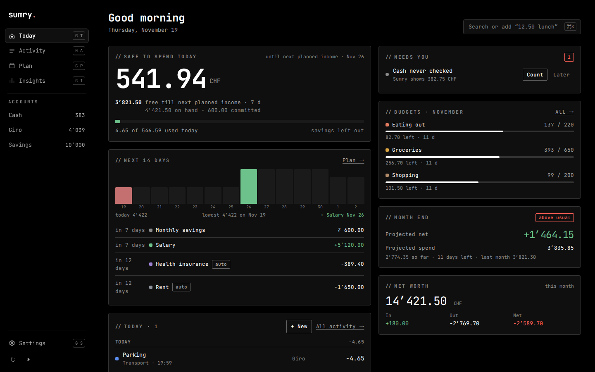
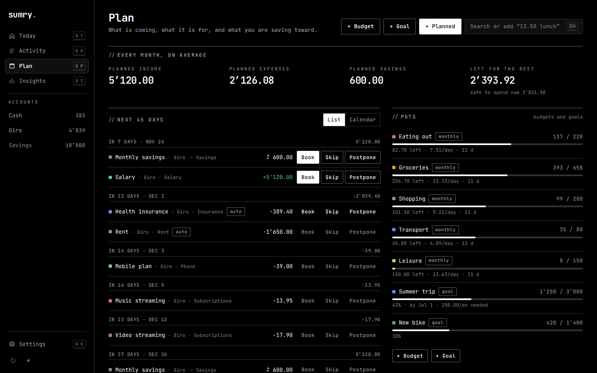
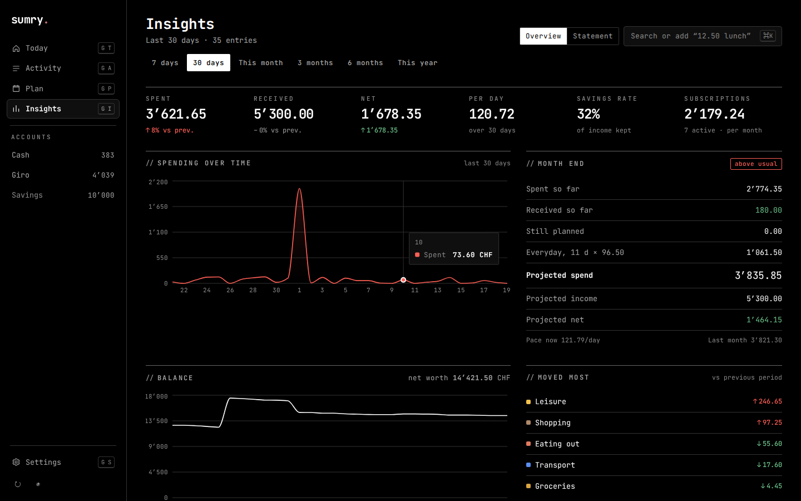
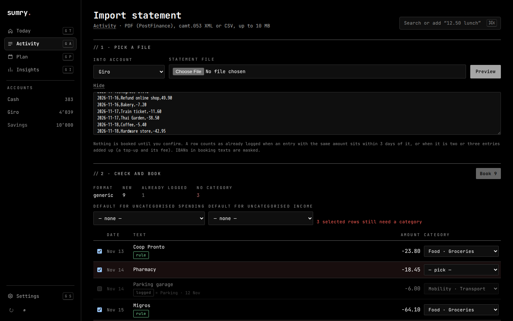

<a id="readme-top"></a>

<div align="center">

<h1>sumry.</h1>

<p><b>A calm personal finance tracker you can host yourself.</b><br>This is the API: Spring Boot and Kotlin on PostgreSQL and Redis.<br>The web app is <a href="https://github.com/elyesghazel/sumry-frontend">sumry-frontend</a>, the phone app <a href="https://github.com/elyesghazel/sumry-app">sumry-app</a>.</p>

<p>
  <a href="https://github.com/elyesghazel/sumry-backend/actions/workflows/ci.yml"></a>
  <a href="LICENSE"></a>
  
  
</p>

<p><a href="#self-host"><b>Self-host</b></a> · <a href="#hosted"><b>Hosted</b></a> · <a href="#features"><b>Features</b></a> · <a href="#configuration"><b>Configuration</b></a> · <a href="#api"><b>API</b></a> · <a href="#development"><b>Development</b></a></p>

</div>

---



Sumry shows how much you can spend today without touching what is already planned, where
the month is heading and what is due next. You log entries in a line of text
(`12.50 lunch cash`), import bank statements, and plan the rest. No bank login, no tracking,
no ads: the data lives in your own Postgres.

## Features

- **Safe to spend.** What is free until the next planned income, after rent, bills and
  savings transfers that are still due, split into a daily amount.
- **Accounts in any currency.** Each entry keeps the rate at booking and its value in your
  base currency, so reports add up. ECB rates, cached.
- **Quick add.** `12.50 kebab cash yesterday`, `got 300 salary`, `500 from giro to savings`:
  parsed into amount, account, category and date.
- **Plan.** Planned income, bills and transfers that book themselves on the day (or wait for
  a tap), budgets with a start day and rollover, and savings goals with the amount needed per
  month.
- **Statement import.** PostFinance PDF, camt.053 XML from any Swiss bank, and CSV
  (PostFinance, Revolut, or any table with a date and an amount). Nothing is booked until
  you check it; rows already logged are recognised and IBANs are masked.
- **Rules.** Category rules on the entry text, with a test box and a dry run over history.
- **Insights.** Detected subscriptions, a month-end forecast, a monthly statement as a page
  or an email on the 1st.
- **Reconcile.** Bring an account in line with the bank; the gap is booked as an adjustment
  instead of overwriting the balance.
- **Your data stays yours.** CSV and JSON export of every entry. Deleting the account removes
  the user and all their data in one transaction.
- **Apple Pay logging.** A Shortcuts automation can log every card payment with a token that
  only reaches the shortcut endpoints.

| Plan | Insights | Import |
| --- | --- | --- |
|  |  |  |

The screenshots show invented demo data from [`deploy/demo-seed.sh`](deploy/demo-seed.sh).

## Self-host

`deploy/` has the whole stack in one compose file: Postgres 16, Redis, the API, the web app
and Caddy in front, which routes `/api` to the API and gets a certificate on its own when
you set a domain. It needs Docker with Compose v2 and about 1.5 GB of free RAM.

```bash
git clone https://github.com/elyesghazel/sumry-backend.git
cd sumry-backend/deploy
cp .env.example .env
# fill in the two secrets
sed -i "s|^POSTGRES_PASSWORD=.*|POSTGRES_PASSWORD=$(openssl rand -hex 24)|; s|^JWT_SECRET=.*|JWT_SECRET=$(openssl rand -base64 48 | tr -d '\n')|" .env
# set SUMRY_DOMAIN and SUMRY_BOOTSTRAP_ADMIN_EMAIL in .env
docker compose up -d
```

Registration is closed by default. On the first start the API creates the
`SUMRY_BOOTSTRAP_ADMIN_EMAIL` user as admin and prints a one-time password:

```bash
docker compose logs backend | grep "Bootstrap admin"
```

[deploy/README.md](deploy/README.md) covers the rest: inviting people, updates, backups and
restore, hardening, and running a second instance on the same host.

### Mobile

- **iPhone:** open your instance in Safari and add it to the home screen. It runs as an app
  (see [Install on iPhone](https://github.com/elyesghazel/sumry-frontend#install-on-iphone-pwa)).
- **Android:** install the APK from the [sumry-app releases](https://github.com/elyesghazel/sumry-app/releases)
  and enter your server address on the sign-in screen.

### Try it with demo data

`deploy/demo-seed.sh` registers `demo@example.com` and fills about three months of invented
entries, budgets, planned items, rules and goals. It needs `SUMRY_REGISTRATION_MODE=open`,
`curl`, `jq` and GNU `date`. Only use it on a throwaway instance.

```bash
SUMRY_URL=http://localhost ./deploy/demo-seed.sh
```

## Hosted

Elyes Ghazel runs a hosted Sumry for people who don't want to run a server. It is the same
code as this repository, with plan limits switched on:

| Plan | Price | |
|---|---|---|
| Free | 0 | 2 accounts, no statement import, no statement email |
| Premium | 2 CHF / month or 18 CHF / year | everything |
| Founder Lifetime | 29 CHF once | everything, for the first 50 users only |

Payment is manual via TWINT for now; after payment the admin switches the account to
Premium. A self-hosted instance has none of this: every feature is free.

## Configuration

Everything is set through environment variables. In the self-host stack they go in
`deploy/.env`, which lists each one with a comment.

| Variable | Default | |
|---|---|---|
| `JWT_SECRET` | (required) | Signs session tokens. Base64, at least 32 bytes: `openssl rand -base64 48` |
| `POSTGRES_PASSWORD` | (required) | Database password in the self-host stack |
| `SPRING_DATASOURCE_URL` / `_USERNAME` / `_PASSWORD` | local compose values | Database, when you run the API outside `deploy/` |
| `SPRING_DATA_REDIS_HOST` / `_PORT` | `localhost` / `6379` | Redis, used for rate limits, sign-out and FX rates |
| `SUMRY_DOMAIN` | empty | Public domain for Caddy. Empty serves plain HTTP on port 80 |
| `SUMRY_HTTP_PORT` / `SUMRY_HTTPS_PORT` | `80` / `443` | Host ports Caddy is published on |
| `SUMRY_VERSION` | `latest` | Image tag for API and web app, e.g. `v1.0.0` |
| `SUMRY_BOOTSTRAP_ADMIN_EMAIL` | empty | First admin, created on an empty database with a one-time password in the log |
| `SUMRY_REGISTRATION_MODE` | `closed` | `closed`, `invite` (needs a code from an admin) or `open` |
| `JWT_EXPIRATION_MS` | `86400000` | Session length (24 h) |
| `SUMRY_CORS_ALLOWED_ORIGINS` | empty in `deploy/` | Extra browser origins, comma-separated. Not needed for the bundled web app |
| `SPRINGDOC_ENABLED` | `false` | Swagger UI at `/swagger-ui.html` |
| `SUMRY_MAIL_HOST` / `_PORT` / `_USER` / `_PASSWORD` / `_FROM` | empty / `587` | SMTP for the monthly statement. Empty host = mail off |
| `SUMRY_MAIL_AUTH` / `SUMRY_MAIL_STARTTLS` | `true` / `true` | SMTP options |
| `SUMRY_STATEMENT_SCHEDULED` | `false` | Email last month's statement to every user on the 1st |
| `SUMRY_LIMITS_ENABLED` | `false` | Plan limits, see below |
| `SUMRY_FREE_MAX_ACCOUNTS` | `2` | Accounts a `FREE` user may have while limits are on |
| `SUMRY_AI_BRIDGE_URL` / `SUMRY_AI_BRIDGE_TOKEN` | empty | Optional Claude check on imports, see below |
| `SUMRY_AI_USERS` | empty | Who may use it: user ids or emails, comma-separated |

### Plan limits

Off unless `SUMRY_LIMITS_ENABLED=true`, and off is what a self-hosted instance wants: every
user then has every feature. With limits on, `FREE` users get at most
`SUMRY_FREE_MAX_ACCOUNTS` accounts, no statement import and no statement email. Blocked calls
answer 403 `{"error":"plan_limit","limit":"accounts|statement_import|statement_email"}`.

This is what the [hosted instance](#hosted) uses: Free with 2 accounts, no import and no
statement email,
Premium for 2 CHF a month or 18 CHF a year, Founder Lifetime for 29 CHF (first 50 users).
There is no payment code. Payment happens outside the app (TWINT), and an admin sets the
user's plan with `POST /api/admin/users/{id}/plan`.

### AI check on imports

An optional second look at a statement import by Claude, through a small bridge on the host
that runs `claude -p`. It is off unless the bridge URL, its token and `SUMRY_AI_USERS` are all
set, and only the listed users can call it; everyone else gets 403 and the bridge is never
called. `GET /api/users/me` reports `aiEnabled` so the web app can hide the button. Nothing
else in Sumry needs it.

### What an admin can see

Users with role `ADMIN` manage the instance, not other people's money. Every `/api/admin`
route checks the role on the server. The user list (`GET /api/admin/users`) shows, per user:
username, email, role, plan, active or locked, signup date, last sign-in, the first
characters of the invite code they used, and how many accounts and transactions they have.
Counts only: no balances, amounts, descriptions, notes or categories. `GET /api/admin/stats`
returns totals: users, locked users, premium users, signups per week over the last 12 weeks,
and the database size.

What an admin can do:

- **Set the plan** (`POST /api/admin/users/{id}/plan`).
- **Lock and unlock.** A lock refuses sign-in and ends every session and Shortcut token the
  user holds at once. Unlocking lets them sign in again; the old tokens stay revoked.
- **Delete** a user with all their data.
- **Issue a password reset.** This creates a one-time token, valid for 24 hours, shown to the
  admin once; only a hash is stored. Until reset mails exist, the admin passes it on by hand,
  and the user redeems it with `POST /api/users/password-reset`, which signs them out
  everywhere.
- Manage invites. An admin cannot lock or delete their own account through these routes.

There is no impersonation and no route to sign in as another user. Every admin action (plan,
lock, unlock, delete, password reset, invite created or revoked) writes a row to an audit log,
readable with `GET /api/admin/audit`: which admin, which user, what, when. Audit rows stay when
a user is deleted, with the user id left as a bare id that no longer resolves to a name; the
audit detail never holds a username, email or invite note.

A password reset is the one action that gives an admin a way into an account: whoever holds
the token can set a new password. It is in the audit log, and the user notices because their
old password stops working and all their sessions end.

This protects users from the app, not from the operator. Whoever runs the server and has
access to the database, its backups or the host can read every row, including all
transactions. Entries are not end-to-end encrypted. Only use an instance whose operator you
trust, or run your own.

## API

Every route under `/api` needs a bearer token from `POST /api/users/login`, except
`users/register`, `users/password-reset`, `GET /api/config` and `/actuator/health`.

| Area | Routes |
|---|---|
| Session | `users/login`, `users/logout`, `users/logout-all`, `users/password`, `users/preferences`, `users/me` (profile, plan, limits, `aiEnabled`) |
| Registration | `users/register` (takes `inviteCode` in invite mode), `config` (public, `{registrationMode}`) |
| Account deletion | `DELETE users/me` with `{"password": "..."}`: removes the user and all their data in one transaction |
| Admin | `admin/users` (counts only), `admin/stats`, `admin/audit?page=&size=`; per user `admin/users/{id}/plan`, `/lock`, `/unlock`, `/password-reset`, `DELETE admin/users/{id}`; `admin/invites` creates (`{expiresInDays?, note?}`, the code is shown once), lists, and `DELETE admin/invites/{id}` revokes (role ADMIN) |
| Password reset | `users/password-reset` (public) with `{"token": "...", "newPassword": "..."}` redeems a token from `admin/users/{id}/password-reset` |
| Accounts | `users/accounts` CRUD, `reconcile/{id}` books the gap to the real balance; accounts carry a currency |
| Transactions | `transactions/` list, `transactions/search` (filtered, paged, with sums), `transactions/quick` (natural language), transfers, `cashflow/{account}` |
| Categories | `category/user`, `category/`, `category/label` |
| Budgets | `budgets`, `budgets/progress?date=`: periods, start day, rollover, pace |
| Planned | `planned`, `planned/{id}/book`, `skip`, `postpone`, `planned/upcoming`, `planned/safe-to-spend`; a job books the ones set to auto |
| Goals | `goals`, `goals/{id}/contribute` |
| Rules | `rules`, `rules/test`, `rules/apply?dryRun=` |
| Insights | `insights/subscriptions`, `insights/forecast` |
| Import / export | `import/preview`, `import/check` (AI, optional), `import/commit`, `export/transactions.csv` and `.json` |
| Statement | `statement?month=`, `statement/html`, `statement/send` (needs `SUMRY_MAIL_*`) |
| Shortcut | `shortcut/categories`, `shortcut/log` with a token from `users/shortcut-token` |
| FX | `fx?base=`: ECB rates via frankfurter.dev, cached in Redis |

Money is `numeric(14,2)`. Each transaction stores its account currency, the rate at booking
and `baseAmount` in the user's base currency, which is what every report sums. The schema is
owned by Flyway (`src/main/resources/db/migration`); Hibernate only validates it.

## Development

Needs JDK 21 and Docker.

```bash
./gradlew test                    # integration tests run against Postgres and Redis in Testcontainers
cp .env.example .env              # fill in fresh local values
docker compose up -d --build      # API on :48090 with Postgres and Redis
```

The web app's dev server proxies `/api` to `localhost:48090`, so
[sumry-frontend](https://github.com/elyesghazel/sumry-frontend) runs against this with
`npm run dev`. Pushes to `main` publish `ghcr.io/elyesghazel/sumry-backend:latest`, tags
`v*` publish a release image.

See [CONTRIBUTING.md](CONTRIBUTING.md) for commits and tests, and [SECURITY.md](SECURITY.md)
to report a vulnerability.

## License

[AGPL-3.0](LICENSE). You may self-host Sumry, change it and use it commercially. If you
modify it and offer it to others as a service over a network, you have to publish the source
of your modified version under the same license.

The name "Sumry" and the logo are not part of the license: forks and public hosts use their
own name. See [TRADEMARK.md](TRADEMARK.md). Contributions are accepted under the
[CLA in CONTRIBUTING.md](CONTRIBUTING.md#contributor-license-agreement).

<div align="right"><a href="#readme-top">back to top ↑</a></div>
